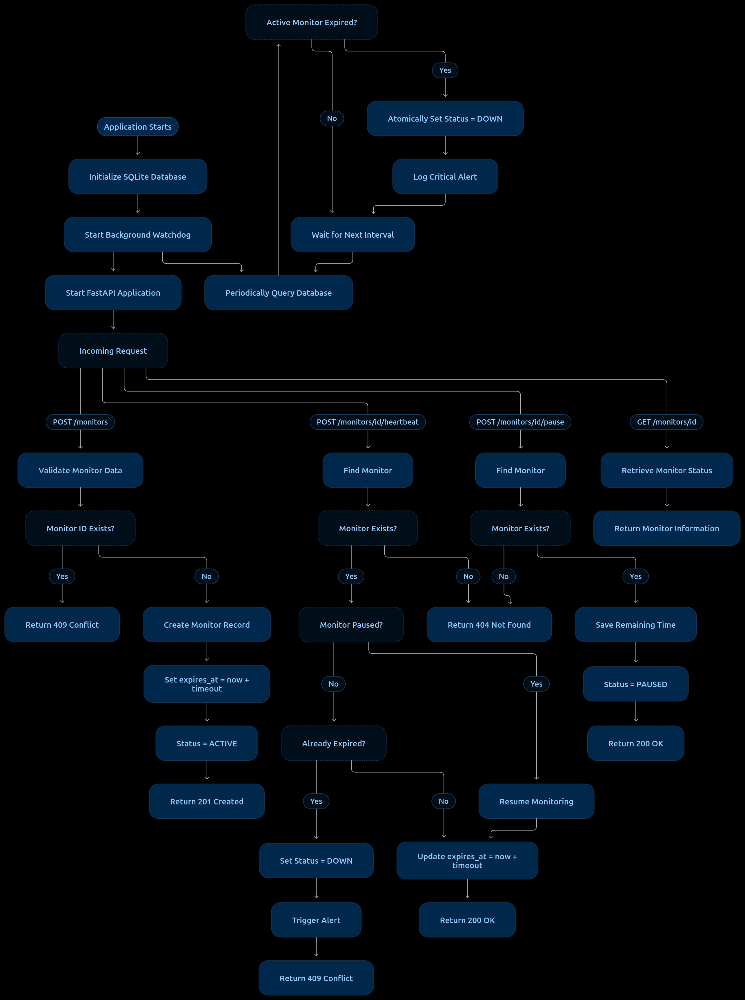

# Pulse Check API — Watchdog Sentinel

A lightweight asynchronous monitoring API built with **FastAPI, SQLAlchemy, SQLite, and asyncio**.

Pulse Check implements a Dead Man's Switch mechanism for monitoring remote devices. Devices periodically send heartbeats to indicate that they are operational. If a device fails to send a heartbeat before its configured timeout, the system automatically detects the failure, changes its status to `DOWN`, and triggers an alert.

## Features

- **Monitor Registration:** Register devices with configurable heartbeat timeouts.
- **Heartbeat Management:** Reset expiration deadlines whenever a device sends a heartbeat.
- **Automatic Failure Detection:** Background watchdog periodically detects expired monitors.
- **Alert Triggering:** Automatically logs a critical alert when a device goes offline.
- **Pause and Resume:** Temporarily suspend monitoring and automatically resume it upon receiving a heartbeat.
- **Monitor Status Inspection:** Retrieve the current state and expiration information of any registered device.
- **Asynchronous Architecture:** Built using FastAPI, SQLAlchemy's async interface, and asyncio.
- **Automated Testing:** Integration and service tests using pytest.

---

## 1. Architecture

### Technology Stack

| Component | Technology | Responsibility |
|---|---|---|
| API Framework | FastAPI | REST API endpoints |
| Database | SQLite | Persistent monitor storage |
| ORM | SQLAlchemy | Database operations |
| Validation | Pydantic | Request and response validation |
| Background Processing | asyncio | Watchdog execution |
| Testing | pytest | Automated testing |

### System Architecture (Flowchart)




### Monitor State Machine

Each monitor has one of three states:

- `ACTIVE`: Device is being monitored.
- `DOWN`: Device missed its heartbeat deadline.
- `PAUSED`: Monitoring has been temporarily suspended.

### Watchdog Design

The watchdog is an asynchronous background task started through FastAPI's lifespan mechanism.

It periodically queries SQLite for monitors satisfying:

```sql
SELECT id
FROM monitors
WHERE status = 'ACTIVE'
AND expires_at <= CURRENT_TIMESTAMP;
```

For each candidate, it attempts an atomic state transition:

```sql
UPDATE monitors
SET status = 'DOWN',
    alerted_at = CURRENT_TIMESTAMP
WHERE id = <monitor_id>
AND status = 'ACTIVE'
AND expires_at <= CURRENT_TIMESTAMP
AND alerted_at IS NULL;
```

Only a successful state transition triggers an alert.

This prevents repeated alerts for the same failure event and protects against competing state transitions.

---

## 2. Project Structure

```text
Pulse-Check/
│
├── app/
│   ├── __init__.py
│   ├── main.py
│   │
│   ├── api/
│   │   ├── __init__.py
│   │   └── routes.py
│   │
│   ├── core/
│   │   ├── __init__.py
│   │   └── config.py
│   │
│   ├── database/
│   │   ├── __init__.py
│   │   ├── database.py
│   │   └── models.py
│   │
│   ├── schemas/
│   │   ├── __init__.py
│   │   └── monitor.py
│   │
│   ├── services/
│   │   ├── __init__.py
│   │   ├── monitor_service.py
│   │   └── watchdog.py
│   │
│   └── utils/
│       └── __init__.py
│
├── tests/
│   ├── __init__.py
│   ├── conftest.py
│   ├── test_monitors.py
│   └── test_watchdog.py
│
├── .env.example
├── .gitignore
├── pytest.ini
├── requirements.txt
└── README.md
```

---

## 3. Installation and Setup

### Prerequisites

- Python 3.12+
- pip
- Git

### Clone the repository

```bash
git clone <YOUR_FORK_URL>
cd <root_directory>/backend/Pulse-Check
```

### Create a virtual environment

```bash
python3 -m venv .venv

source .venv/bin/activate
```

### Install dependencies

```bash
python -m pip install --upgrade pip

pip install -r requirements.txt
```

### Configure environment variables

Create a local environment file:

```bash
cp .env.example .env
```

Default configuration:

```env
APP_NAME=Pulse Check API
APP_VERSION=1.0.0
DEBUG=true

DATABASE_URL=sqlite+aiosqlite:///./pulse_check.db

WATCHDOG_INTERVAL=1.0
```

The SQLite database is created automatically when the application starts.

### Start the application

```bash
uvicorn app.main:app --reload
```

The API will be available at:

```text
http://127.0.0.1:8000
```

Interactive API documentation:

```text
http://127.0.0.1:8000/docs
```

---

## 4. API Documentation

### 4.1 Health Check

**GET `/health`**

Checks API availability and database connectivity.

Example:

```bash
curl http://127.0.0.1:8000/health
```

Successful response:

```json
{
    "status": "healthy",
    "application": "Pulse Check API",
    "database": "connected"
}
```

### 4.2 Register a Monitor

**POST `/monitors`**

Registers a device for heartbeat monitoring.

Request:

```json
{
    "id": "device-123",
    "timeout": 60,
    "alert_email": "admin@critmon.com"
}
```

Example:

```bash
curl -X POST http://127.0.0.1:8000/monitors \
-H "Content-Type: application/json" \
-d '{
    "id": "device-123",
    "timeout": 60,
    "alert_email": "admin@critmon.com"
}'
```

Successful response: `201 Created`

```json
{
    "id": "device-123",
    "timeout": 60,
    "alert_email": "admin@critmon.com",
    "status": "ACTIVE",
    "created_at": "2026-11-12T10:00:00",
    "last_heartbeat_at": "2026-11-12T10:00:00",
    "expires_at": "2026-11-12T10:01:00"
}
```

Possible errors:

| Status | Description |
|---|---|
| 409 | Monitor ID already exists |
| 422 | Invalid request data |

### 4.3 Send a Heartbeat

**POST `/monitors/{monitor_id}/heartbeat`**

Resets the monitor's expiration deadline.

The new expiration timestamp is calculated as:

\[
T_{\text{expiry}} = T_{\text{current}} + T_{\text{timeout}}
\]

Example:

```bash
curl -X POST \
http://127.0.0.1:8000/monitors/device-123/heartbeat
```

Successful response: `200 OK`

```json
{
    "message": "Heartbeat received successfully.",
    "id": "device-123",
    "status": "ACTIVE",
    "expires_at": "2026-11-12T10:02:00"
}
```

A heartbeat automatically resumes a paused monitor.

Possible errors:

| Status | Description |
|---|---|
| 404 | Monitor does not exist |
| 409 | Monitor has expired or is DOWN |

### 4.4 Pause Monitoring

**POST `/monitors/{monitor_id}/pause`**

Temporarily suspends monitoring.

Example:

```bash
curl -X POST \
http://127.0.0.1:8000/monitors/device-123/pause
```

Successful response: `200 OK`

```json
{
    "message": "Monitoring paused successfully.",
    "id": "device-123",
    "status": "PAUSED",
    "remaining_seconds": 45.5
}
```

While paused, the watchdog ignores the monitor.

Sending another heartbeat automatically resumes monitoring and resets its expiration deadline.

Possible errors:

| Status | Description |
|---|---|
| 404 | Monitor does not exist |
| 409 | Monitor is already paused, DOWN, or expired |

### 4.5 Retrieve Monitor Status

**GET `/monitors/{monitor_id}`**

Retrieves the current state and information associated with a monitor.

Example:

```bash
curl http://127.0.0.1:8000/monitors/device-123
```

Successful response: `200 OK`

```json
{
    "id": "device-123",
    "timeout": 60,
    "alert_email": "admin@critmon.com",
    "status": "ACTIVE",
    "created_at": "2026-11-12T10:00:00",
    "last_heartbeat_at": "2026-11-12T10:00:30",
    "expires_at": "2026-11-12T10:01:30"
}
```

Possible errors:

| Status | Description |
|---|---|
| 404 | Monitor does not exist |

---

## 5. Alert Mechanism

When a device misses its heartbeat deadline, the watchdog transitions its status from `ACTIVE` to `DOWN`.

The system then generates a critical log entry.

Example:

```json
{
    "ALERT": "Device device-123 is down!",
    "time": "2026-11-12T10:01:05+00:00"
}
```

Alerts are currently simulated through Python logging.

The `alert_email` field is stored for future notification integration. Actual email delivery is not implemented in this version.

---

## 6. Developer's Choice: Monitor Status Inspection

### Feature: Monitor Status Endpoint

**GET `/monitors/{monitor_id}`**

The original requirements focused on registration, heartbeat management, and automatic failure detection.

I added an endpoint for retrieving the current status of any registered monitor.

### Why this feature?

A monitoring system should provide visibility into the devices it manages.

Administrators and support engineers need to know:

- Whether a device is currently operational.
- When it last communicated with the API.
- When its next heartbeat deadline occurs.
- Whether monitoring has been paused.
- Whether a failure has already been detected.

Without this endpoint, administrators would need direct database access to inspect device states.


---

## 7. Testing

The project uses `pytest`, `pytest-asyncio`, and HTTPX for automated testing.

Tests run against isolated temporary SQLite databases, keeping them independent of the development database.

### Run the test suite

```bash
pytest -v
```

### Test Coverage

The automated tests cover:

**API Integration Tests**
- Health endpoint and database connectivity.
- Successful monitor registration.
- Duplicate monitor registration.
- Invalid request validation.
- Monitor retrieval.
- Unknown monitor handling.
- Heartbeat expiration reset.
- Unknown monitor heartbeat.
- Monitor pause.
- Automatic resume through heartbeat.
- Repeated pause rejection.
- Unknown monitor pause.
- Late heartbeat rejection and alert triggering.

**Watchdog Tests**
- Automatic detection of expired monitors.
- Prevention of duplicate alerts.
- Exclusion of paused monitors.

---

## 8. License

This project was developed as part of the AmaliTech Backend and AI Application Development apprenticeship technical assessment.